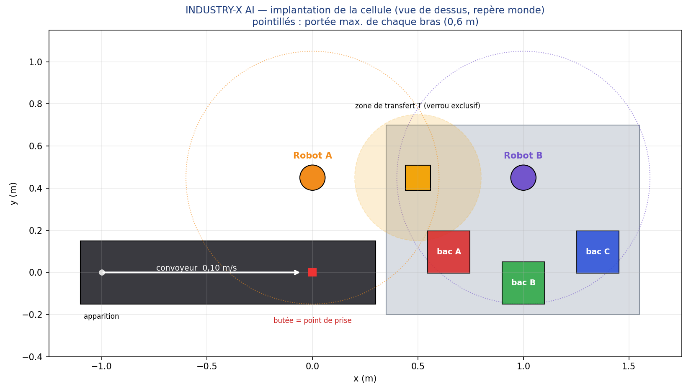
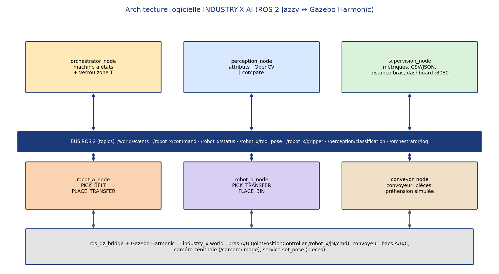

# INDUSTRY-X AI — Cellule industrielle virtuelle de tri d'objets

**EIC 3.0 · Cours Robotique & IA · Professeur : Carlos Yfrazin · Équipe FIREGUARD-X (12 étudiants)**
Remise : mardi 3 novembre 2026, 23h59 · Soutenance : mercredi 4 novembre 2026, 16h

Deux bras manipulateurs robotisés, un convoyeur motorisé et une unité de supervision trient des pièces
colorées (3 couleurs × 2 formes) vers trois bacs A / B / C, **100 % en simulation open-source**
(Ubuntu 24.04 · ROS 2 Jazzy · Gazebo Harmonic · Python 3.12 · OpenCV).



## 1. Démarrage rapide (sur Ubuntu 24.04)

```bash
git clone https://github.com/<organisation>/industry-x-ai-eic3-fireguard.git
cd industry-x-ai-eic3-fireguard
bash scripts/install_ubuntu_ros2_gazebo.sh     # une seule fois (ROS 2 Jazzy + Gazebo Harmonic)
bash scripts/build.sh                          # compile le paquet et génère le monde SDF
bash scripts/run_simulation.sh                 # ouvre Gazebo + lance les 6 nœuds
```

Ensuite : ouvrir **http://localhost:8080** (tableau de bord temps réel). La cellule démarre seule : les bras
se placent en position repos, puis 10 pièces apparaissent, sont saisies par le robot A, transférées au robot B
et triées dans les bacs. Aucune action manuelle n'est nécessaire.

Variantes utiles :

| Besoin | Commande |
|---|---|
| Classification par **caméra OpenCV** (bonus IA) | `bash scripts/run_simulation.sh perception_mode:=opencv` |
| Comparer IA et règle classique | `bash scripts/run_simulation.sh perception_mode:=compare` |
| Test de **robustesse** (25 % d'échecs de préhension injectés) | `bash scripts/run_simulation.sh grasp_failure_rate:=0.25` |
| Sans fenêtre Gazebo | `bash scripts/run_simulation.sh headless:=true` |
| Logique seule, **sans Gazebo** (ROS 2 requis) | `ros2 launch industry_x_ai logic_only.launch.py` |
| Logique seule, **sans ROS ni Gazebo** (Python) | `bash scripts/run_tests.sh` |

## 2. Fonctionnement de la cellule

| Élément | Rôle |
|---|---|
| **Convoyeur** (`conveyor_node`) | Génère une pièce colorée toutes les 8 s, la fait avancer à 0,10 m/s jusqu'à la butée (point de prise), gère la file d'attente. |
| **Robot A** (`robot_a_node`) | Détecte la pièce arrivée, la saisit (`PICK_BELT`) et la dépose en zone de transfert T (`PLACE_TRANSFER`). |
| **Robot B** (`robot_b_node`) | Reprend la pièce en T (`PICK_TRANSFER`), la dépose dans le bac A, B ou C (`PLACE_BIN`). |
| **Perception / IA** (`perception_node`) | Classe la pièce par couleur/forme : règle par attributs ou vision OpenCV (HSV + contours). |
| **Orchestrateur** (`orchestrator_node`) | Machine à états centrale ; **verrou exclusif sur la zone T** → A et B ne s'y trouvent jamais ensemble. |
| **Supervision** (`supervision_node`) | Compteurs, temps de cycle, états robots, **distance minimale entre les bras**, journal CSV/JSON, dashboard Web. |

Règle de tri : rouge → **bac A**, vert → **bac B**, bleu → **bac C** (la forme est classée et journalisée).
Les deux robots travaillent **en parallèle** (pipeline) : pendant que B trie la pièce *n*, A saisit la pièce *n+1*.



## 3. Structure du dépôt

```
industry-x-ai-eic3-fireguard/
├── README.md · CONTRIBUTIONS.md · LICENSE
├── src/industry_x_ai/            # Paquet ROS 2 (ament_python)
│   ├── industry_x_ai/            #   code : *_node.py (ROS) + modules purs testables
│   ├── launch/ · config/         #   simulation.launch.py, logic_only.launch.py, params.yaml
│   └── test/                     #   44 tests unitaires et de robustesse (pytest)
├── simulation/                   # monde Gazebo (.world), modèles SDF des bras, générateur
├── docs/                         # architecture, installation, guide, plan de tests, captures/
├── tests/                        # journal de 10 cycles, logs CSV/JSON, méthodologie
├── presentation/                 # slides PDF (10 diapositives)
├── video/                        # lien vidéo (3-5 min) + scénario
├── scripts/                      # install, build, run, tests, dossier de remise
└── .github/                      # CI (pytest), modèles de PR / issues
```

## 4. Documentation

| Document | Contenu |
|---|---|
| [docs/INSTALLATION.md](docs/INSTALLATION.md) | Installation pas à pas, vérifications, dépannage |
| [docs/GUIDE_UTILISATEUR.md](docs/GUIDE_UTILISATEUR.md) | Lancer, observer, **checklist de validation Gazebo**, captures, vidéo |
| [docs/architecture/ARCHITECTURE.md](docs/architecture/ARCHITECTURE.md) | Nœuds, topics, messages, machine à états, verrou, sécurité |
| [docs/architecture/CHOIX_TECHNIQUES.md](docs/architecture/CHOIX_TECHNIQUES.md) | Justification des choix (et limites assumées) |
| [docs/PLAN_DE_TESTS.md](docs/PLAN_DE_TESTS.md) | Stratégie de tests, critères, robustesse |
| [docs/GITFLOW_ET_PLANNING.md](docs/GITFLOW_ET_PLANNING.md) | GitFlow, planning J1-J15, jalons |
| [docs/PREPARATION_ORALE.md](docs/PREPARATION_ORALE.md) | Questions probables par rôle (maîtrise individuelle) |
| [tests/JOURNAL_10_CYCLES.md](tests/JOURNAL_10_CYCLES.md) | Journal des 10 cycles et métriques |
| [docs/captures/README.md](docs/captures/README.md) | Liste des 8+ captures à produire |

## 5. Tests

```bash
bash scripts/run_tests.sh      # pytest (44 tests) + 3 simulations logiques -> tests/logs/
```

Les tests couvrent : cinématique (IK/FK sur tous les points de passage), distance entre bras, générateur de
trajectoires, convoyeur et file d'attente, **10 cycles nominaux sans collision**, tri aléatoire, **pannes de
préhension injectées** (3 graines : reprise automatique, pas de blocage), exclusion mutuelle en zone T,
classification OpenCV sur images synthétiques (couleur × forme × bruit).

> **Transparence.** `headless_sim` valide la *logique* (mêmes classes que les nœuds ROS) sans Gazebo.
> Il ne remplace pas l'exécution Gazebo : le journal officiel, les captures et la vidéo doivent être produits
> avec `scripts/run_simulation.sh` (voir `docs/GUIDE_UTILISATEUR.md`).

## 6. Correspondance avec la grille d'évaluation (100 pts)

| Critère | Pts | Où le trouver |
|---|---|---|
| Simulation 3D démontrable en direct | 30 | `scripts/run_simulation.sh` (démarrage automatique, aucune manipulation), dashboard, mode `headless`, plan de secours (vidéo) |
| Programmation, coordination, qualité du code ROS 2 | 20 | `fsm.py` (verrou, reprises, timeouts), `robot_controller.py`, nœuds fins, modules purs + 44 tests, CI |
| Intégration des deux bras sans collision | 15 | Verrou zone T, IK vérifiée avant mouvement, monitoring capsules (distance min. journalisée), test exhaustif des poses |
| Tri multi-catégories, journalisation, robustesse | 15 | 3 couleurs × 2 formes → 3 bacs, CSV/JSON par cycle, pannes injectées, `tests/` |
| Documentation et reproductibilité | 10 | Ce README, scripts d'installation/build/run, CI, schémas |
| Répartition du travail, oral, maîtrise individuelle | 10 | `CONTRIBUTIONS.md`, `docs/PREPARATION_ORALE.md`, un fichier = un responsable |

## 7. Dépannage rapide

| Symptôme | Cause / solution |
|---|---|
| `gz: command not found` | Installer Gazebo : `sudo apt install ros-jazzy-ros-gz` puis rouvrir le terminal |
| Les pièces n'apparaissent pas / ne bougent pas | Voir le log du `conveyor_node` : le pont `set_pose` est indisponible → repli automatique `gz_cli` ; forcer avec `pose_backend:=gz_cli` |
| Fenêtre Gazebo noire / lente (pas de GPU) | `headless:=true`, ou `LIBGL_ALWAYS_SOFTWARE=1`, et rester en `perception_mode:=attributes` |
| Bras qui oscillent | Réduire `<p_gain>` / augmenter `<d_gain>` dans `generate_simulation.py` puis `bash scripts/build.sh` |
| Port 8080 occupé | `... dashboard_port:=8090` |
| `Package 'industry_x_ai' not found` | `source install/setup.bash` (ou utiliser `scripts/run_simulation.sh`) |

## 8. Équipe

Voir [CONTRIBUTIONS.md](CONTRIBUTIONS.md). Licence : MIT.
